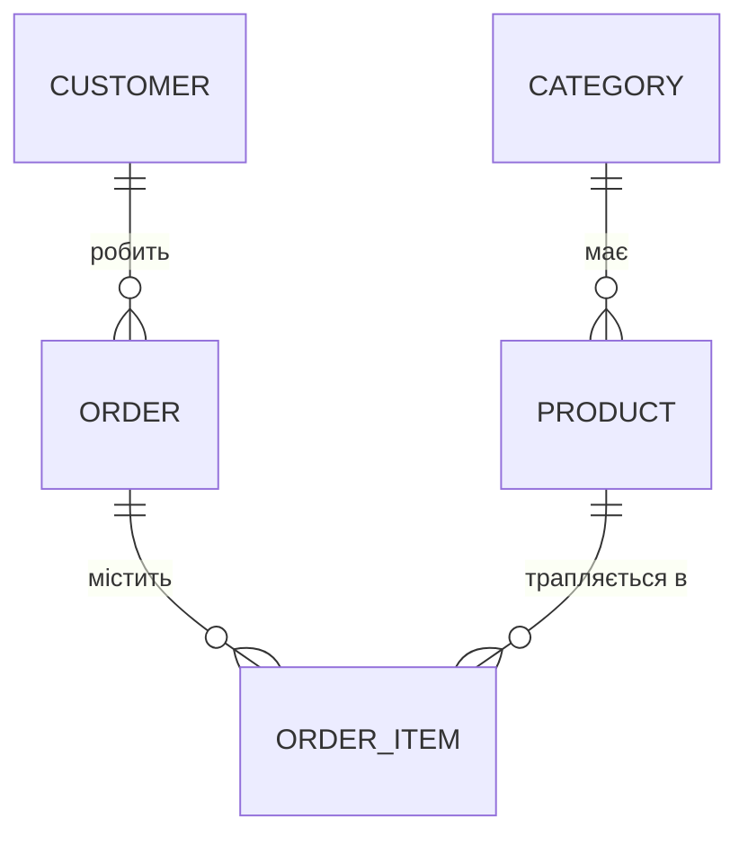

# Module 01 — Лекція 1.1: Реляційні БД, JDBC та ORM

Перше заняття курсу. Ми рухаємось **від даних до коду** маленькими кроками, де кожен крок
випливає з попереднього: дивимось на дані → звʼязуємо таблиці → склеюємо їх запитом →
рахуємо підсумки → і лише потім робимо те саме з Java.

Наскрізний приклад усього курсу — **інтернет-магазин**.

> **Головна ідея курсу:** ORM — не магія. За кожною анотацією стоїть конкретний SQL,
> який ми вмітимемо побачити в логах.

## Що навчимося
- Розуміти **таблицю, рядок, первинний і зовнішній ключ** на реальних даних.
- Бачити звʼязки **1:N** та **N:M** на підсвічених рядках.
- Склеювати таблиці через **INNER / LEFT / RIGHT JOIN** і розуміти, що потрапляє в результат.
- Рахувати підсумки через **GROUP BY / HAVING** (з `WHERE`).
- Робити те саме з Java через **JDBC** і зрозуміти, навіщо **ORM**.

## Передумови
Пройдений [module-00-setup](../module-00-setup/): Docker, (бажано) DBeaver;
для частини B — JDK 17 і Maven.

---

# Частина A — SQL руками

## A1. Таблиця й рядок

Усе починається з таблиці. Ось `products` (товари) — кожен **рядок** це один товар:

```
 products
 ┌────┬────────────────────┬─────────┬─────────────┐
 │ id │ name               │ price   │ category_id │
 ├────┼────────────────────┼─────────┼─────────────┤
 │ 1  │ iPhone 15          │  999.00 │      1      │
 │ 2  │ Samsung Galaxy S24 │  899.00 │      1      │
 │ 3  │ Google Pixel 8     │  699.00 │      1      │
 │ 4  │ MacBook Air        │ 1199.00 │      2      │
 │ 5  │ Dell XPS 13        │ 1099.00 │      2      │
 └────┴────────────────────┴─────────┴─────────────┘
```

- **Рядок** — один обʼєкт реального світу (один товар).
- **Стовпець** — одна його характеристика.
- **`id`** — унікальний номер рядка, **первинний ключ (PK)**.

> Зверніть увагу на стовпець **`category_id`** — це число. Що воно означає? Зʼясуємо далі.

## A2. Звʼязок 1:N — товар належить категорії

Категорії лежать в окремій таблиці. `category_id` у товарі — це **посилання** на рядок
у `categories`:

```
 categories                         products
 ┌────┬─────────┐                   ┌────┬──────────────┬─────────────┐
 │ id │ name    │                   │ id │ name         │ category_id │
 ├────┼─────────┤                   ├────┼──────────────┼─────────────┤
 │ 1  │ Phones  │◄───────┐          │ 1  │ iPhone 15    │      1 ─────┼──┐
 │ 2  │ Laptops │◄────┐  │          │ 2  │ Samsung S24  │      1 ─────┼──┤──► до id=1
 └────┴─────────┘     │  └──────────┤ 3  │ Google Pixel │      1 ─────┼──┘
                      │             │ 4  │ MacBook Air  │      2 ─────┼──┐
                      └─────────────┤ 5  │ Dell XPS 13  │      2 ─────┼──┴──► до id=2
                                    └────┴──────────────┴─────────────┘
```

**Читаємо картинку:** товари 1, 2, 3 усі мають `category_id = 1` → всі належать категорії
**Phones**. Товари 4, 5 мають `category_id = 2` → категорія **Laptops**.

- Одна категорія → **багато** товарів. Це звʼязок **1:N** (один-до-багатьох).
- **Зовнішній ключ (FK)** — стовпець `products.category_id`, що посилається на `categories.id`.

> **FK гарантує цілісність:** база не дасть вставити товар із `category_id = 99`,
> бо категорії 99 не існує.

## A3. Звʼязок N:M — товар і замовлення

Складніший випадок. Одне **замовлення** містить багато товарів, а один **товар** може бути
в багатьох замовленнях. Це **N:M** (багато-до-багатьох) — і його не виразити одним стовпцем.

Потрібна **звʼязкова таблиця** `order_items`. Кожен її рядок поєднує *одне* замовлення
з *одним* товаром:

```
 orders              order_items                      products
 ┌────┬────────┐     ┌────┬──────────┬────────────┐   ┌────┬──────────────┐
 │ id │ status │     │ id │ order_id │ product_id │   │ id │ name         │
 ├────┼────────┤     ├────┼──────────┼────────────┤   ├────┼──────────────┤
 │ 1  │ PAID   │◄────┤ 1  │    1     │     1  ─────┼──►│ 1  │ iPhone 15    │
 │    │        │◄────┤ 2  │    1     │     4  ─────┼─┐ │ 4  │ MacBook Air  │
 │ 2  │ NEW    │◄────┤ 3  │    2     │     1  ──┐  │ └►│    │              │
 └────┴────────┘     └────┴──────────┴──────────┼──┼───┴────┴──────────────┘
                                                │  └──► товар 4 → замовлення 1
                       товар 1 → замовлення 1 ──┴─────► товар 1 → ще й замовлення 2
```

**Читаємо картинку:**
- Замовлення **1** містить **два** товари (рядки 1 і 2 в `order_items`: товари 1 та 4).
- Товар **1** (iPhone) трапляється у **двох** замовленнях (рядки 1 і 3: замовлення 1 та 2).

> Саме тому `order_items` і потрібна: вона розкладає «багато-до-багатьох» на набір простих
> рядків «один-до-одного». Плюс у ній зручно зберігати кількість і ціну на момент покупки.

### Повна схема магазину



| Звʼязок | Тип | Як зроблено |
|---|---|---|
| Category → Product | **1:N** | `products.category_id` → `categories.id` |
| Customer → Order | **1:N** | `orders.customer_id` → `customers.id` |
| Order → OrderItem | **1:N** | `order_items.order_id` → `orders.id` |
| Product ↔ Order | **N:M** | через `order_items` (дві FK) |

## A4. SELECT і WHERE — дістаємо рядки

Тепер дістаємо дані запитом. Найпростіше — вибрати стовпці й відфільтрувати рядки.

**Дані** (`products` з A1) → **запит** → **результат**:

```sql
SELECT name, price
FROM products
WHERE price > 900;
```

Що робить `WHERE`: перевіряє **кожен рядок** і лишає тільки ті, де умова істинна:

```
 id │ name               │ price     WHERE price > 900?
────┼────────────────────┼─────────  ──────────────────
 1  │ iPhone 15          │  999.00   ✓ 999 > 900  → лишаємо
 2  │ Samsung Galaxy S24 │  899.00   ✗ 899 > 900  → відкидаємо
 3  │ Google Pixel 8     │  699.00   ✗             → відкидаємо
 4  │ MacBook Air        │ 1199.00   ✓             → лишаємо
 5  │ Dell XPS 13        │ 1099.00   ✓             → лишаємо
```

**Результат:**
```
 name         | price
--------------+---------
 iPhone 15    |  999.00
 MacBook Air  | 1199.00
 Dell XPS 13  | 1099.00
```

## A5. JOIN — склеюємо дві таблиці

У `products` є `category_id` (число), але немає **назви** категорії. Щоб її показати,
треба «склеїти» `products` з `categories` за звʼязком FK → PK. Це робить `JOIN`.

```sql
SELECT p.name AS product, c.name AS category
FROM products p
JOIN categories c ON c.id = p.category_id;   -- умова склеювання: FK = PK
```

**Як JOIN шукає пару для кожного рядка** (бере `category_id` і знаходить рядок у `categories`):

```
 products                         categories
 name          category_id        id  name
 ────────────  ───────────        ──  ────────
 iPhone 15     ──── 1 ───────────► 1   Phones     склеїли:  iPhone 15  | Phones
 MacBook Air   ──── 2 ───────────► 2   Laptops    склеїли:  MacBook    | Laptops
 Dell XPS 13   ──── 2 ───────────► 2   Laptops    склеїли:  Dell XPS   | Laptops
```

**Результат:**
```
 product      | category
--------------+----------
 iPhone 15    | Phones
 MacBook Air  | Laptops
 Dell XPS 13  | Laptops
```

## A6. Види JOIN — на тих самих даних

Різні види JOIN по-різному поводяться з рядками, у яких **немає пари**. Щоб побачити різницю,
візьмемо дані, де пари навмисно бракує з обох боків:

```
 customers (ліва)              orders (права)
 ┌────┬───────────────┐        ┌────┬─────────────┬────────┐
 │ id │ full_name     │        │ id │ customer_id │ status │
 ├────┼───────────────┤        ├────┼─────────────┼────────┤
 │ 1  │ Alice Johnson │        │ 1  │     1       │ PAID   │  → Alice
 │ 2  │ Bob Smith     │        │ 2  │     1       │ NEW    │  → Alice
 │ 3  │ Carol White   │        │ 3  │     2       │ SHIP   │  → Bob
 └────┴───────────────┘        │ 9  │     7 (?)   │ NEW    │  → клієнта 7 НЕМА
                               └────┴─────────────┴────────┘
```

- **Carol (id=3)** не має жодного замовлення.
- Замовлення **9** посилається на клієнта **7**, якого немає в `customers`.

### INNER JOIN — тільки пари, що є в ОБОХ

```sql
SELECT cu.full_name, o.status
FROM customers cu
INNER JOIN orders o ON o.customer_id = cu.id;
```

```
 full_name     │ status     коментар
 ────────────  │ ───────    ─────────────────────────
 Alice Johnson │ PAID    ✓
 Alice Johnson │ NEW     ✓
 Bob Smith     │ SHIP    ✓
 ✗ Carol White              немає замовлень → ВИПАЛА
 ✗ (order 9)                немає клієнта 7  → ВИПАЛО
```

> **INNER JOIN** лишає тільки рядки, що мають пару **з обох боків**. Усе без пари зникає.

### LEFT JOIN — усі з ЛІВОЇ таблиці

```sql
SELECT cu.full_name, o.status
FROM customers cu
LEFT JOIN orders o ON o.customer_id = cu.id;
```

```
 full_name     │ status
 ────────────  │ ───────
 Alice Johnson │ PAID
 Alice Johnson │ NEW
 Bob Smith     │ SHIP
 Carol White   │ NULL   ◄── Carol лишилась! пари немає → status = NULL
```

> **LEFT JOIN** лишає **всі** рядки лівої таблиці (`customers`). Де пари немає — права
> частина заповнюється `NULL`. Так ми **не губимо** клієнтів без замовлень.

### RIGHT JOIN — усі з ПРАВОЇ таблиці

```sql
SELECT cu.full_name, o.status
FROM customers cu
RIGHT JOIN orders o ON o.customer_id = cu.id;
```

```
 full_name     │ status
 ────────────  │ ───────
 Alice Johnson │ PAID
 Alice Johnson │ NEW
 Bob Smith     │ SHIP
 NULL          │ NEW    ◄── замовлення 9 лишилось! клієнта 7 немає → full_name = NULL
```

> **RIGHT JOIN** — дзеркало LEFT: лишає **всі** рядки правої таблиці (`orders`).
> «Осиротіле» замовлення 9 лишається, а імʼя клієнта — `NULL`.

### Коротко: яку таблицю «зберігаємо повністю»

```
 INNER JOIN  →  тільки спільне (перетин)         A ∩ B
 LEFT  JOIN  →  вся ліва  + спільне               A
 RIGHT JOIN  →  вся права + спільне                 B
 FULL  JOIN  →  усе з обох (зрідка; PostgreSQL)   A ∪ B
```

## A7. GROUP BY — підсумки по групах

Інколи треба не окремі рядки, а **підсумок**: скільки товарів у кожній категорії. Це
`GROUP BY` + агрегатна функція (`count`, `sum`, `avg`).

### Крок 1 — дані, які групуватимемо

Беремо товари з категоріями (після JOIN) і подумки розкладаємо на купки:

```
 category     | product              групи
--------------+--------------------  ─────────────────────
 Phones       | iPhone 15           ┐
 Phones       | Samsung Galaxy S24  ├─ купка "Phones"  → count = 3
 Phones       | Google Pixel 8      ┘
 Laptops      | MacBook Air         ┐
 Laptops      | Dell XPS 13         ┘─ купка "Laptops" → count = 2
 Accessories  | USB-C Cable         ┐
 Accessories  | Phone Case          ├─ купка "Accessories" → count = 3
 Accessories  | Wireless Charger    ┘
```

### Крок 2 — запит (додаємо WHERE)

Порахуємо товари в кожній категорії, але врахуємо лише **дорожчі за 20**
(`WHERE` — фільтр рядків ДО групування):

```sql
SELECT c.name AS category, count(p.id) AS products_count
FROM categories c
JOIN products p ON p.category_id = c.id
WHERE p.price > 20                 -- 1) спершу відсіюємо дешеві рядки
GROUP BY c.name                    -- 2) потім групуємо решту за категорією
ORDER BY products_count DESC;
```

### Крок 3 — результат

```
 category    | products_count
-------------+----------------
 Phones      |       3
 Laptops     |       2
 Accessories |       2     ◄── було 3, але USB-C Cable (19.00) відсіяв WHERE
```

> **Правило GROUP BY:** усе у `SELECT` поза агрегатом має бути перелічене в `GROUP BY`.

## A8. WHERE проти HAVING

Обидва фільтрують, але на різних етапах конвеєра:

```
 рядки ──►[ WHERE ]──► групування ──►[ HAVING ]──► результат
           фільтрує                   фільтрує
           ОКРЕМІ рядки               ГОТОВІ групи
           (ще до count)              (можна count)
```

```sql
SELECT c.name, count(p.id) AS cnt
FROM categories c
JOIN products p ON p.category_id = c.id
GROUP BY c.name
HAVING count(p.id) > 2;      -- умова на АГРЕГАТ → це HAVING, не WHERE
```

Результат: лишаться тільки **Phones (3)** і **Accessories (3)**; Laptops (2) відсіється.

---

# Частина B — JDBC vs ORM

Ми вміємо писати SQL. Тепер — як виконати той самий SQL **із коду Java**.

## B1. Що таке JDBC

**JDBC** (Java Database Connectivity) — стандартний API Java для роботи з базою.
Його головні обʼєкти:

| Обʼєкт | Що це |
|---|---|
| **`DriverManager`** | «фабрика», що відкриває нове **зʼєднання** з базою |
| **`Connection`** | саме зʼєднання — відкритий канал до бази |
| **`PreparedStatement`** | підготовлений SQL-запит із параметрами (`?`) |
| **`ResultSet`** | результат запиту — рядки, по яких «йдемо» курсором |

> **Зʼєднання (Connection)** — відкритий канал між застосунком і базою, через який ходять
> запити. Це перший термін, який треба засвоїти.

## B2. Куди класти дані — клас Product

Прочитаний рядок треба кудись покласти в Java. Робимо клас-контейнер із полями під кожен
стовпець:

```java
// Один обʼєкт цього класу = один рядок таблиці products.
class Product {
    long id;             // ← стовпець id
    String name;         // ← стовпець name
    BigDecimal price;    // ← стовпець price (гроші → BigDecimal, НЕ double!)
    int quantity;        // ← стовпець quantity
}
```

**Відповідність стовпець → поле (мапінг):**
```
 рядок у products             обʼєкт Product у Java
 ┌──────────────────┐         ┌───────────────────────┐
 │ id       = 1     │ ──────► │ id       = 1          │
 │ name     = iPhone│ ──────► │ name     = "iPhone"   │
 │ price    = 999.00│ ──────► │ price    = 999.00     │
 │ quantity = 10    │ ──────► │ quantity = 10         │
 └──────────────────┘         └───────────────────────┘
```

> Поки що ми **самі** перекладаємо кожен стовпець у поле. Нижче побачимо, скільки це коду.

## B3. Читання одного товару через JDBC

Збираємо все разом. Щоб прочитати **один рядок**: відкрити зʼєднання → підготувати запит →
підставити параметр → пройтись по `ResultSet` → **вручну** перекласти стовпці → усе закрити.

```java
String sql = "SELECT id, name, price, quantity FROM products WHERE id = ?";

try (Connection conn = DriverManager.getConnection(URL, USER, PASSWORD);   // 1. зʼєднання
     PreparedStatement ps = conn.prepareStatement(sql)) {                  // 2. запит
    ps.setLong(1, id);                                                     // 3. параметр замість ?

    try (ResultSet rs = ps.executeQuery()) {                               // 4. виконати
        if (rs.next()) {
            Product p = new Product();
            p.id       = rs.getLong("id");          // 5. ❌ ручний мапінг
            p.name     = rs.getString("name");      //    стовпець → поле
            p.price    = rs.getBigDecimal("price");
            p.quantity = rs.getInt("quantity");
            return p;
        }
        return null;
    }
}
```

Повний приклад — у [`src/main/java/com/shop/JdbcDemo.java`](src/main/java/com/shop/JdbcDemo.java).

**Проблеми JDBC:**
- ❌ багато повторюваного коду навіть для одного рядка;
- ❌ **ручний мапінг**: назви й типи пишемо руками — помилка випливе лише під час виконання;
- ❌ для звʼязків (замовлення з позиціями) код росте лавиноподібно.

## B4. Транзакція

> **Транзакція** — група операцій, що мають виконатись **разом або не виконатись зовсім**.

Створити замовлення + позицію = **два** `INSERT`. Якщо після першого станеться збій,
у базі не має лишитися «напівзамовлення».

```sql
BEGIN;
INSERT INTO orders (customer_id, status) VALUES (1, 'NEW') RETURNING id;   -- крок 1
INSERT INTO order_items (order_id, product_id, quantity, unit_price)
VALUES (4, 1, 1, 999.00);                                                  -- крок 2
COMMIT;                                            -- або ROLLBACK — скасувати все
```

```
 BEGIN ─► крок 1 ─► крок 2 ─► COMMIT    ✅ обидва кроки збережено
 BEGIN ─► крок 1 ─► ✗ збій ─► ROLLBACK  ↩ усе скасовано, база як до BEGIN
```

JDBC: `setAutoCommit(false)`=`BEGIN`, `commit()`=`COMMIT`, `rollback()`=`ROLLBACK`.

### ACID

| | Властивість | Простими словами |
|---|---|---|
| **A** | Atomicity | Усе або нічого |
| **C** | Consistency | Після транзакції дані лишаються коректними |
| **I** | Isolation | Паралельні транзакції не заважають одна одній |
| **D** | Durability | Після `COMMIT` збережеться навіть за збою |

## B5. Те саме через Spring Data — навіщо ORM

Увесь код читання з B3 через Spring Data стискається **в один рядок**:

```java
Product p = productRepository.findById(id).orElse(null);
```

Хто виконав увесь JDBC (зʼєднання, запит, мапінг)? **ORM.**

> **ORM** (Object-Relational Mapping) — автоматичне відображення між **рядками** таблиць
> і **обʼєктами** Java. Те, що в B3 ми робили руками, ORM робить сам.

### Impedance mismatch — чому ORM узагалі потрібен

```
   СВІТ БАЗИ (реляційний)          СВІТ JAVA (обʼєктний)
 ┌─────────────────────┐        ┌─────────────────────────┐
 │ плоскі таблиці       │  ORM   │ обʼєкти з посиланнями    │
 │ рядки + зовнішні     │ ◄────► │ поля-обʼєкти             │
 │ ключі (числа)        │        │ (Product має Category)   │
 └─────────────────────┘        └─────────────────────────┘
```

| У базі (SQL) | У Java (обʼєкти) |
|---|---|
| `products.category_id` → `categories.id` | `class Product { Category category; }` |
| рядок у `order_items` | `List<OrderItem> items` в `Order` |

> Ціна зручності: ORM інколи генерує **не той SQL**, який ми очікуємо (класика — проблема
> **N+1**, якою завершиться курс у [module-06-liquibase-nplus1](../module-06-liquibase-nplus1/)).
> **Тому** ми з першого заняття вмикаємо лог SQL.

## B6. Стек технологій — хто за що (знизу вгору)

ORM у Java — це **кілька шарів один на одному**. Знизу драйвер говорить із базою, Hibernate
генерує SQL, Spring Data дає зручні репозиторії:

```
 ┌──────────────────────────────────────────────┐
 │ Ваш код:  Controller → Service → Repository   │  те, що пишете ви
 ├──────────────────────────────────────────────┤
 │ Spring Data JPA — готові репозиторії          │  save/findById без коду
 ├──────────────────────────────────────────────┤
 │ JPA — специфікація (@Entity, JPQL)            │  «правила гри» ORM
 ├──────────────────────────────────────────────┤
 │ Hibernate — реалізація JPA                    │  ГЕНЕРУЄ й виконує SQL
 ├──────────────────────────────────────────────┤
 │ JDBC + драйвер PostgreSQL                     │  фундамент (з B3)
 ├──────────────────────────────────────────────┤
 │ PostgreSQL                                    │  сама база
 └──────────────────────────────────────────────┘
   Liquibase — збоку: версіонує СХЕМУ бази як код у git
```

---

## Запуск

### Частина A (SQL руками)
```bash
docker compose up -d
docker compose exec -T db psql -U shop -d shop < sql/01-create-tables.sql
docker compose exec -T db psql -U shop -d shop < sql/02-insert-data.sql
# далі — запити з 03-select-basics.sql та 04-group-by.sql
```

### Частина B (JDBC-демо)
```bash
mvn compile exec:java        # база має бути піднята й наповнена
```

---

## Типові помилки

| Повідомлення / симптом | Причина | Як виправити |
|---|---|---|
| `relation "products" does not exist` | Таблиці ще не створені | Спершу `01-create-tables.sql` |
| `insert ... violates foreign key constraint` | Вставляєте рядок із неіснуючим `category_id` | Спочатку вставте категорію |
| `column "p.name" must appear in the GROUP BY clause` | Стовпець у `SELECT` поза агрегатом і не в `GROUP BY` | Додати в `GROUP BY` або обернути агрегатом |
| `Connection refused` при `JdbcDemo` | База не запущена | `docker compose up -d` |

---

## Завдання для самостійного виконання

**Частина A (SQL руками):**
1. Товари дорожчі за 100, відсортовані за ціною спадання.
2. Назва товару + назва категорії (`INNER JOIN`), лише `Phones`.
3. Усі клієнти та кількість їхніх замовлень (`LEFT JOIN` + `GROUP BY`), включно з тими, у кого 0.
4. Усі замовлення + імʼя клієнта, включно з «осиротілими» (`RIGHT JOIN`) — поясніть, де `NULL`.
5. Категорії із середньою ціною товару понад 500 (`WHERE` + `GROUP BY` + `HAVING`).

**Частина B (JDBC/ORM):**
6. У `JdbcDemo` знайдіть: де відкривається **зʼєднання**, де **мапінг** стовпців у поля,
   де межі **транзакції**.
7. Поясніть: що станеться з даними, якщо між двома `INSERT` станеться збій, а транзакції
   **немає**.

---

## Чеклист DoD

- [ ] Можу прочитати ER-діаграму; розумію PK, FK, звʼязки 1:N та N:M на даних.
- [ ] Можу пояснити на рядках різницю **INNER / LEFT / RIGHT JOIN** і де зʼявляється `NULL`.
- [ ] Можу написати `GROUP BY` з `WHERE`; відрізняю `WHERE` від `HAVING`.
- [ ] Знаю обʼєкти JDBC і розумію, як стовпці мапляться в поля `Product`.
- [ ] Можу пояснити зʼєднання, транзакцію (`COMMIT`/`ROLLBACK`), ACID, ORM.

---

## Що далі

У **[module-02-first-entity](../module-02-first-entity/)** створимо справжній Spring Boot
проєкт і першу сутність `@Entity Product`. Hibernate сам згенерує `CREATE TABLE` — і ми
порядково звіримо **кожну анотацію з рядком SQL**.
