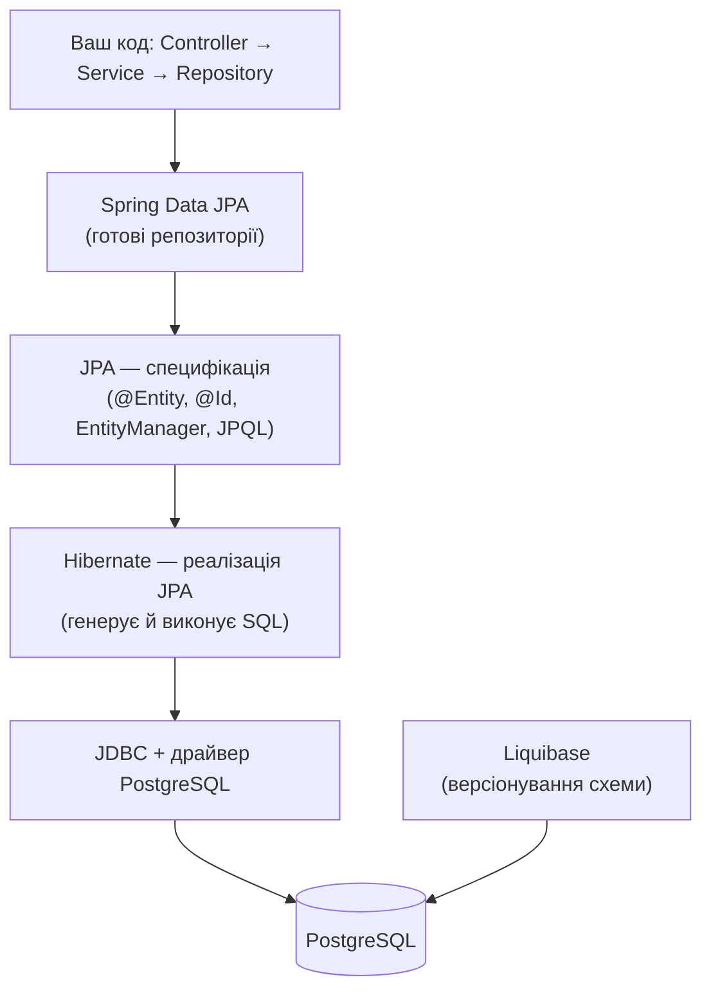
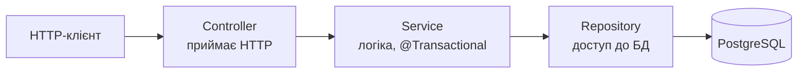

# Module 01 — Лекція 1.1: Реляційні БД, JDBC та ORM

Перше заняття курсу. Складається з двох частин:

- **Частина A — SQL руками.** Працюємо з базою **PostgreSQL** напряму мовою **SQL**:
  створюємо таблиці, наповнюємо даними, пишемо запити, включно з агрегацією `GROUP BY`.
  Жодного Java-коду.
- **Частина B — JDBC vs ORM.** Виконуємо той самий SQL **із коду Java** через «голий» JDBC
  (і бачимо, скільки це зайвого коду), розбираємо **зʼєднання**, **сесію** і **транзакцію**,
  та зʼясовуємо, навіщо потрібен **ORM**.

Усе, що ви напишете руками в частині A, пізніше згенерує за вас Hibernate — і щоразу ви
впізнаватимете цей самий SQL у логах. Тому фреймворк не буде «чорною скринькою».

## Що навчимося
- Створювати таблиці (`CREATE TABLE`) і розуміти **первинний** та **зовнішній** ключі.
- Бачити **звʼязки між таблицями**: 1:N та N:M на прикладі магазину.
- Писати запити: `SELECT`, `WHERE`, `ORDER BY`, `JOIN`, а також `GROUP BY` / `HAVING`.
- Розуміти, **як будується SQL-запит** — порядок і призначення секцій.
- Розуміти **зʼєднання**, **транзакцію** (`BEGIN/COMMIT/ROLLBACK`, ACID) і ціну JDBC.
- Орієнтуватися в стеку **JPA → Hibernate → Spring Data JPA → Liquibase**.

## Передумови
Пройдений [module-00-setup](../module-00-setup/): встановлено Docker, (бажано) DBeaver;
для частини B — JDK 17 і Maven.

## Структура теки
```
module-01-rdb-jdbc-orm/
├─ docker-compose.yml        база PostgreSQL
├─ sql/                      Частина A — скрипти SQL (Maven не потрібен)
│  ├─ 01-create-tables.sql
│  ├─ 02-insert-data.sql
│  ├─ 03-select-basics.sql
│  └─ 04-group-by.sql
├─ pom.xml                   Частина B — Maven-проєкт JDBC-демо
└─ src/main/java/com/shop/JdbcDemo.java
```

---

# Частина A — SQL руками

## A1. Запуск бази

У теці модуля лежить `docker-compose.yml`. Піднімаємо базу:

```bash
docker compose up -d
```

Перевіряємо, що контейнер працює:

```bash
docker ps
```

Має бути рядок з образом `postgres:16` і статусом `Up`.

## A2. Підключення до бази

Є два способи. Достатньо будь-якого.

### Спосіб А — термінал (psql усередині контейнера)

```bash
docker compose exec db psql -U shop -d shop
```

- `docker compose exec db` — виконати команду всередині контейнера з ім'ям `db`.
- `psql -U shop -d shop` — запустити клієнт `psql`, користувач `shop`, база `shop`.

Ви потрапите в інтерактивний режим із запрошенням `shop=#`. Корисні команди psql
(вводяться без крапки з комою): `\dt` — список таблиць; `\d products` — структура таблиці;
`\q` — вийти.

### Спосіб Б — DBeaver (графічно)

Нове підключення PostgreSQL: host `localhost`, port `5432`, database `shop`,
user `shop`, password `shop`. Далі відкривайте SQL-редактор і виконуйте запити.

## A3. Скрипти

У теці `sql/` — чотири файли, виконуйте **по порядку**:

| Файл | Що робить |
|---|---|
| `sql/01-create-tables.sql` | Створює 5 таблиць магазину |
| `sql/02-insert-data.sql`   | Наповнює їх прикладами даних |
| `sql/03-select-basics.sql` | Базові запити: `SELECT`, `WHERE`, `ORDER BY`, `JOIN` |
| `sql/04-group-by.sql`      | Агрегація: `GROUP BY`, `COUNT/SUM/AVG`, `HAVING` |

**Запустити цілий файл із терміналу:**

```bash
docker compose exec -T db psql -U shop -d shop < sql/01-create-tables.sql
docker compose exec -T db psql -U shop -d shop < sql/02-insert-data.sql
```

> Прапорець `-T` потрібен, коли ми «згодовуємо» файл через `<`.

Або копіюйте вміст у DBeaver / psql і виконуйте **блок за блоком**, читаючи коментарі —
для навчання це наочніше.

## A4. Таблиці та звʼязки магазину

Стрілка `──<` читається як «один до багатьох».

```
  categories                 products
  ┌────┬─────────┐           ┌────┬──────────────┬────────┬──────────┬─────────────┐
  │ id │ name    │           │ id │ name         │ price  │ quantity │ category_id │
  ├────┼─────────┤           ├────┼──────────────┼────────┼──────────┼─────────────┤
  │ 1  │ Phones  │ ──┐       │ 1  │ iPhone 15    │ 999.00 │    10    │      1 ─────┼──┐
  │ 2  │ Laptops │   │       │ 4  │ MacBook Air  │1199.00 │     5    │      2      │  │
  └────┴─────────┘   │       └────┴──────────────┴────────┴──────────┴─────────────┘  │
                     └──────────────────────── 1 категорія ──< N товарів ─────────────┘
```

**Два види ключів:**
- **Первинний ключ (PRIMARY KEY)** — стовпець `id`, унікальний номер рядка.
- **Зовнішній ключ (FOREIGN KEY)** — стовпець, що **посилається** на `id` іншої таблиці.
  Напр. `products.category_id` вказує на `categories.id`. База не дасть вставити товар
  із неіснуючою категорією — так гарантується цілісність даних.

**Типи звʼязків у магазині:**

| Звʼязок | Тип | Як зроблено |
|---|---|---|
| Category → Product | 1:N | `products.category_id` → `categories.id` |
| Customer → Order | 1:N | `orders.customer_id` → `customers.id` |
| Order → OrderItem | 1:N | `order_items.order_id` → `orders.id` |
| Product ↔ Order | **N:M** | через проміжну таблицю `order_items` |

> **Чому N:M потребує окремої таблиці.** Одне замовлення містить багато товарів, і один товар
> трапляється в багатьох замовленнях. Такий звʼязок не можна виразити одним стовпцем —
> потрібна **звʼязкова таблиця** `order_items`, що поєднує замовлення й товар (та зберігає
> кількість і ціну).

## A5. Як будується SQL-запит

Повна форма `SELECT` має фіксований **порядок секцій**:

```sql
SELECT   -- які стовпці вивести
FROM     -- з якої таблиці
JOIN     -- які таблиці приєднати і за якою умовою
WHERE    -- якими рядками обмежитись (фільтр ДО групування)
GROUP BY -- як згрупувати рядки
HAVING   -- фільтр ПІСЛЯ групування (працює з агрегатами)
ORDER BY -- як відсортувати результат
LIMIT    -- скільки рядків повернути
```

Але пишемо ми в одному порядку, а база **виконує** в іншому:

```
   FROM / JOIN  →  WHERE  →  GROUP BY  →  HAVING  →  SELECT  →  ORDER BY  →  LIMIT
```

Саме тому, напр., у `WHERE` ще не можна використати псевдонім зі `SELECT` — база до нього
ще не дійшла.

### JOIN — поєднання за звʼязком

```sql
SELECT p.name AS product, c.name AS category
FROM products p
JOIN categories c ON c.id = p.category_id;   -- умова з'єднання = рівність FK та PK
```

- `INNER JOIN` (просто `JOIN`) лишає тільки рядки, для яких є пара в обох таблицях.
- `LEFT JOIN` лишає **всі** рядки лівої таблиці; якщо пари немає — праві стовпці `NULL`
  (так ми побачимо клієнтку Carol, у якої немає замовлень).

Усі запити з поясненнями — у `sql/03-select-basics.sql`.

## A6. Агрегація: GROUP BY

```sql
-- скільки товарів у кожній категорії
SELECT c.name AS category, count(p.id) AS products_count
FROM categories c
JOIN products p ON p.category_id = c.id
GROUP BY c.name
ORDER BY products_count DESC;
```

```
 category    | products_count
-------------+----------------
 Phones      |       3
 Accessories |       3
 Laptops     |       2
```

**Правило GROUP BY:** усе, що у `SELECT` поза агрегатною функцією, має бути в `GROUP BY`.

**`HAVING` проти `WHERE`:** `WHERE` фільтрує **окремі рядки ДО** групування; `HAVING` —
**готові групи ПІСЛЯ** (з агрегатами):

```sql
SELECT c.name, count(p.id) AS cnt
FROM categories c
JOIN products p ON p.category_id = c.id
GROUP BY c.name
HAVING count(p.id) > 2;      -- лише категорії, де > 2 товарів
```

Приклад суми кожного замовлення (`SUM(quantity * unit_price)`) та `HAVING` — у `sql/04-group-by.sql`.

---

# Частина B — JDBC vs ORM

## B1. Той самий SELECT, але з Java — через JDBC

**JDBC** — базовий, найнижчий спосіб працювати з базою з Java. Подивіться метод
`findProductById` у [`src/main/java/com/shop/JdbcDemo.java`](src/main/java/com/shop/JdbcDemo.java).
Щоб прочитати **один рядок**, доводиться: відкрити зʼєднання, підготувати запит, підставити
параметр, пройтись по `ResultSet`, **вручну** перекласти кожен стовпець у поле обʼєкта,
і все акуратно закрити.

```java
String sql = "SELECT id, name, price, quantity FROM products WHERE id = ?";
try (Connection conn = DriverManager.getConnection(URL, USER, PASSWORD);
     PreparedStatement ps = conn.prepareStatement(sql)) {
    ps.setLong(1, id);
    try (ResultSet rs = ps.executeQuery()) {
        if (rs.next()) {
            Product p = new Product();
            p.price = rs.getBigDecimal("price");   // ручний мапінг стовпець -> поле
            ...
        }
    }
}
```

Проблеми: багато повторюваного коду; ручний мапінг (помилка виявиться лише під час виконання);
для складних обʼєктів зі звʼязками код розростається лавиноподібно.

> **Тизер усього курсу.** Те саме через Spring Data буде одним рядком:
> `productRepository.findById(id)` — а **той самий SQL** ми побачимо в логах.

### Запуск прикладу (необовʼязково)

```bash
docker compose up -d                                                   # підняти базу (якщо ще ні)
docker compose exec -T db psql -U shop -d shop < sql/01-create-tables.sql
docker compose exec -T db psql -U shop -d shop < sql/02-insert-data.sql
mvn compile exec:java                                                  # запустити демо
```

## B2. Зʼєднання (Connection) і пул зʼєднань

**Зʼєднання** — відкритий канал між застосунком і базою. Відкрити його — **дорога операція**.
Тому реальні застосунки тримають **пул зʼєднань** (connection pool) — набір уже відкритих
зʼєднань, що перевикористовуються. У Spring Boot за це відповідає **HikariCP** автоматично.

## B3. Транзакція: BEGIN / COMMIT / ROLLBACK

**Транзакція** — група операцій, що мають виконатись **разом або не виконатись зовсім**.
Класика — створити замовлення й додати позицію (два `INSERT`). Якщо другий крок впаде,
у базі не має лишитися «напівзамовлення».

### Руками в psql

```sql
BEGIN;                                             -- почати транзакцію
INSERT INTO orders (customer_id, status)
VALUES (1, 'NEW') RETURNING id;                    -- напр. повернуло id = 4
INSERT INTO order_items (order_id, product_id, quantity, unit_price)
VALUES (4, 1, 1, 999.00);
COMMIT;                                            -- зафіксувати; або ROLLBACK — скасувати все
```

Той самий сценарій у Java — у `createOrderWithItem` (`JdbcDemo.java`):
`setAutoCommit(false)` = `BEGIN`, `conn.commit()` = `COMMIT`, `conn.rollback()` = `ROLLBACK`.

### ACID

| Літера | Властивість | Простими словами |
|---|---|---|
| **A** | Atomicity | Усе або нічого |
| **C** | Consistency | Після транзакції дані лишаються коректними |
| **I** | Isolation | Паралельні транзакції не заважають одна одній |
| **D** | Durability | Після `COMMIT` дані збережуться навіть за збою |

> **Підводка.** У Spring замість ручних `BEGIN/COMMIT/ROLLBACK` ставимо анотацію
> **`@Transactional`** — фреймворк сам відкриє транзакцію й зробить `COMMIT` (або `ROLLBACK`
> при винятку).

## B4. Звʼязки між таблицями → поля-обʼєкти в Java

У частині A звʼязки виражалися зовнішніми ключами. В обʼєктному світі — полями-обʼєктами:

| У базі (SQL) | У Java (обʼєкти) |
|---|---|
| `products.category_id` → `categories.id` | `class Product { Category category; }` |
| рядок у `order_items` | елемент списку `List<OrderItem> items` в `Order` |

Саме це й робить **ORM**. Детально реалізуємо у [module-04-associations](../module-04-associations/).

## B5. ORM і impedance mismatch

**ORM** (Object-Relational Mapping) — відображення між **обʼєктами** в коді та **рядками**
в таблицях. Проблема, яку він вирішує, — **impedance mismatch**: у Java дані це обʼєкти
з посиланнями, у базі — плоскі таблиці. ORM бере рутину перекладу на себе.

Ціна зручності: ORM інколи генерує **не той SQL**, який ми очікуємо (класика — **N+1**,
якою завершиться курс у [module-06-liquibase-nplus1](../module-06-liquibase-nplus1/)).
Тому ми й вчимося читати лог SQL.

## B6. Стек технологій



| Технологія | Що це | Роль |
|---|---|---|
| **JPA** | Специфікація | Описує, *як має виглядати* ORM: `@Entity`, `EntityManager`, JPQL. Сама не виконує. |
| **Hibernate** | Реалізація JPA | Генерує й виконує SQL. |
| **Spring Data JPA** | Надбудова | Готові репозиторії: інтерфейс → `save/findById/findAll` без реалізації. |
| **Liquibase** | Міграції | Версіонує **схему** бази як код у git. |
| **JDBC** | Низькорівневий API | Фундамент, на якому все вище працює. |

## B7. Архітектура застосунку



Кожен шар має одну відповідальність: контролер — HTTP, сервіс — логіку/транзакції,
репозиторій — доступ до бази.

---

## Типові помилки

| Повідомлення / симптом | Причина | Як виправити |
|---|---|---|
| `relation "products" does not exist` | Таблиці ще не створені | Спершу `01-create-tables.sql` |
| `insert or update ... violates foreign key constraint` | Вставляєте рядок із неіснуючим `category_id`/`customer_id` | Спочатку вставте батьківський рядок |
| `column "p.name" must appear in the GROUP BY clause ...` | Стовпець у `SELECT` поза агрегатом і не в `GROUP BY` | Додати в `GROUP BY` або обернути агрегатом |
| `password authentication failed` | Невірні логін/пароль | user/password = `shop`/`shop` |
| `Connection refused` при запуску `JdbcDemo` | База не запущена | `docker compose up -d` |

---

## Завдання для самостійного виконання

**Частина A (SQL руками):**
1. Усі товари дорожчі за 100, відсортовані за ціною спадання.
2. Назва товару + назва категорії (`JOIN`), лише `Phones`.
3. Усі клієнти та кількість їхніх замовлень (`LEFT JOIN` + `GROUP BY`), включно з тими, у кого 0.
4. Сума кожного замовлення (`SUM(quantity * unit_price)` + `GROUP BY`), найдорожче зверху.
5. Категорії із середньою ціною товару понад 500 (`GROUP BY` + `HAVING`).

**Частина B (JDBC/ORM):**
6. Намалюйте ER-діаграму магазину (5 таблиць, ключі, звʼязки 1:N і N:M).
7. У psql виконайте сценарій «замовлення + позиція» двічі: з `COMMIT` і з `ROLLBACK`;
   після кожного перевірте `SELECT * FROM orders ORDER BY id DESC LIMIT 3;` і поясніть різницю.

---

## Чеклист DoD

- [ ] База піднята (`docker ps` показує `postgres:16`).
- [ ] Виконано `01`/`02`; перевірочний запит дає 3/8/3/3/7 рядків.
- [ ] Зрозуміла різниця `JOIN` vs `LEFT JOIN` та `WHERE` vs `HAVING`.
- [ ] Можу пояснити порядок секцій запиту й що таке первинний/зовнішній ключ.
- [ ] Можу пояснити зʼєднання, транзакцію (`COMMIT`/`ROLLBACK`), ACID.
- [ ] Можу назвати ролі JPA, Hibernate, Spring Data JPA, Liquibase.
- [ ] (Опц.) Запустив `JdbcDemo` і виконав транзакцію руками.

---

## Що далі

У **[module-02-first-entity](../module-02-first-entity/)** створимо справжній Spring Boot
проєкт і першу сутність `@Entity Product`. Hibernate сам згенерує `CREATE TABLE` — і ми
порядково звіримо **кожну анотацію з рядком SQL**.
