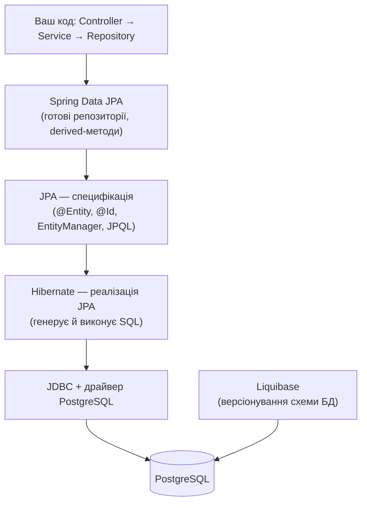
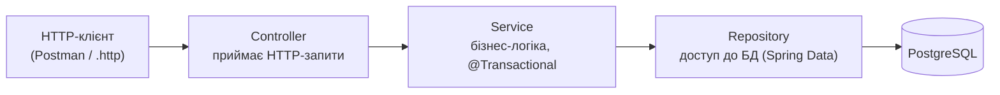

# Module 02 — JDBC vs ORM: зʼєднання, сесія, транзакція

У модулі 01 ми працювали з базою напряму мовою SQL. Тепер подивимося, як виконати
той самий SQL **із коду Java** — спершу «вручну» через **JDBC**, і побачимо, скільки це
зайвого коду. Потім розберемо три поняття, без яких далі нікуди: **зʼєднання**, **сесія**
і **транзакція**, — і зрозуміємо, навіщо з'являється **ORM**.

## Що навчимося
- Читати й записувати дані з Java через **JDBC** (і відчути, чому це незручно).
- Розуміти, що таке **зʼєднання (Connection)** і **пул зʼєднань**.
- Розуміти **транзакцію**: `BEGIN / COMMIT / ROLLBACK`, властивості **ACID**.
- Бачити, як **зв'язки між таблицями** з модуля 01 перетворюються на поля-обʼєкти в Java.
- Орієнтуватися в стеку: **JPA → Hibernate → Spring Data JPA → Liquibase** — хто за що відповідає.

## Передумови
- Пройдений [module-01-sql-by-hand](../module-01-sql-by-hand/): є розуміння таблиць, ключів, запитів.
- Для запуску Java-прикладу — встановлена **JDK 17** і **Maven** (див. [module-00](../module-00-setup/)).

---

## 1. Той самий SELECT, але з Java — через JDBC

**JDBC** (Java Database Connectivity) — базовий, найнижчий спосіб працювати з базою з Java.
Подивіться на метод `findProductById` у [`src/main/java/com/shop/JdbcDemo.java`](src/main/java/com/shop/JdbcDemo.java).
Щоб прочитати **один рядок**, доводиться:

1. відкрити зʼєднання (`DriverManager.getConnection(...)`);
2. підготувати запит (`prepareStatement`);
3. підставити параметр замість `?` (`ps.setLong(1, id)`);
4. виконати й отримати `ResultSet`;
5. **вручну** перекласти кожен стовпець у поле обʼєкта (`p.price = rs.getBigDecimal("price")`);
6. акуратно все закрити.

```java
String sql = "SELECT id, name, price, quantity FROM products WHERE id = ?";
try (Connection conn = DriverManager.getConnection(URL, USER, PASSWORD);
     PreparedStatement ps = conn.prepareStatement(sql)) {
    ps.setLong(1, id);
    try (ResultSet rs = ps.executeQuery()) {
        if (rs.next()) {
            Product p = new Product();
            p.id = rs.getLong("id");
            p.name = rs.getString("name");
            p.price = rs.getBigDecimal("price");   // ручний мапінг стовпець -> поле
            p.quantity = rs.getInt("quantity");
            return p;
        }
        return null;
    }
}
```

Проблеми такого підходу:
- **Багато повторюваного коду** (boilerplate) навіть для простого запиту.
- **Ручний мапінг**: назви стовпців і типи вказуємо руками; помилка виявиться лише під час виконання.
- Для складних обʼєктів зі зв'язками (замовлення з позиціями) код розростається лавиноподібно.

> **Тизер усього курсу.** Те саме через Spring Data буде одним рядком:
> ```java
> Product p = productRepository.findById(id).orElse(null);
> ```
> Весь код вище Hibernate згенерує й виконає за нас. А **той самий SQL** ми побачимо в логах —
> саме так, як налаштовували в [module-00](../module-00-setup/).

### Запуск прикладу (необовʼязково, але корисно)

```bash
docker compose up -d                                                  # підняти базу
docker compose exec -T db psql -U shop -d shop < ../module-01-sql-by-hand/sql/01-create-tables.sql
docker compose exec -T db psql -U shop -d shop < ../module-01-sql-by-hand/sql/02-insert-data.sql
mvn compile exec:java                                                 # запустити демо
```

---

## 2. Зʼєднання (Connection) і пул зʼєднань

**Зʼєднання** — це відкритий канал між застосунком і базою, через який ідуть запити.
У прикладі це обʼєкт `Connection`.

Важливо: **відкрити зʼєднання — дорога операція** (мережа, автентифікація). Якщо відкривати
нове зʼєднання на кожен запит, застосунок буде повільним. Тому реальні застосунки
тримають **пул зʼєднань** (connection pool) — набір уже відкритих зʼєднань, які
перевикористовуються. У Spring Boot за це відповідає **HikariCP** — і все відбувається
автоматично, нам не треба писати `DriverManager.getConnection` руками.

---

## 3. Транзакція: BEGIN / COMMIT / ROLLBACK

**Транзакція** — група операцій, які мають виконатись **разом або не виконатись зовсім**.

Класичний приклад — створити замовлення й додати до нього позицію. Це два `INSERT`.
Якщо після першого кроку щось зламається, у базі не має лишитися «напівзамовлення»
без позицій.

### Транзакція руками в psql

Підніміть базу й зайдіть у psql:

```bash
docker compose up -d
docker compose exec db psql -U shop -d shop
```

Виконайте по кроках:

```sql
BEGIN;                                             -- почати транзакцію

INSERT INTO orders (customer_id, status)
VALUES (1, 'NEW') RETURNING id;                    -- припустимо, повернуло id = 4

INSERT INTO order_items (order_id, product_id, quantity, unit_price)
VALUES (4, 1, 1, 999.00);

-- Варіант 1: усе добре — фіксуємо зміни
COMMIT;

-- Варіант 2: передумали / сталася помилка — скасовуємо ВСЕ
-- ROLLBACK;
```

- `BEGIN` — відкрити транзакцію (далі зміни ще «не остаточні»).
- `COMMIT` — зафіксувати; зміни стають видимими всім і незворотними.
- `ROLLBACK` — скасувати; база повертається у стан до `BEGIN`.

Той самий сценарій у Java — у методі `createOrderWithItem` (`JdbcDemo.java`):
`setAutoCommit(false)` = `BEGIN`, `conn.commit()` = `COMMIT`, `conn.rollback()` = `ROLLBACK`.

### ACID — чому транзакції важливі

| Літера | Властивість | Простими словами |
|---|---|---|
| **A** | Atomicity (атомарність) | Усе або нічого: або всі кроки, або жодного |
| **C** | Consistency (узгодженість) | Після транзакції дані лишаються коректними (ключі, обмеження) |
| **I** | Isolation (ізоляція) | Паралельні транзакції не заважають одна одній |
| **D** | Durability (стійкість) | Після `COMMIT` дані збережуться навіть за збою живлення |

> **Підводка до наступних модулів.** У Spring замість ручних `BEGIN/COMMIT/ROLLBACK` ми
> поставимо над методом анотацію **`@Transactional`** — і фреймворк сам відкриє транзакцію
> на початку методу та зробить `COMMIT` у кінці (або `ROLLBACK`, якщо виняток).

---

## 4. Зв'язки між таблицями → поля-обʼєкти в Java

У модулі 01 зв'язки виражалися **зовнішніми ключами** (стовпець `category_id`).
В обʼєктному світі зв'язок виражається **полем-обʼєктом**. Порівняйте:

| У базі (SQL) | У Java (обʼєкти) |
|---|---|
| `products.category_id` → `categories.id` | `class Product { Category category; }` |
| рядок у `order_items` | елемент списку `List<OrderItem> items` в `Order` |

Тобто замість того, щоб тримати «число-посилання» `category_id`, обʼєкт `Product`
прямо міститиме обʼєкт `Category`. Саме цим і займається **ORM** — перетворює рядки таблиць
на звʼязані між собою обʼєкти (і навпаки). Детально реалізуємо це в
[module-05-associations](../module-05-associations/).

---

## 5. Що таке ORM і impedance mismatch

**ORM** (Object-Relational Mapping) — відображення між **обʼєктами** в коді та **рядками**
в таблицях.

Проблема, яку він вирішує, зветься **object-relational impedance mismatch** — «неспівпадіння»
двох світів: у Java дані — це обʼєкти з посиланнями й наслідуванням, а в базі — плоскі таблиці
з рядками та зовнішніми ключами. ORM бере на себе рутину перекладу одного в інше (той самий
ручний мапінг із пункту 1, тільки автоматично).

Ціна зручності: ORM інколи генерує **не той SQL, який ми очікуємо** (класична пастка — проблема
**N+1**, якою завершиться курс у [module-07](../module-07-liquibase-nplus1/)). Саме тому ми й
вчимося читати лог SQL — щоб тримати ORM під контролем.

---

## 6. Стек технологій: хто за що відповідає



| Технологія | Що це | Роль |
|---|---|---|
| **JPA** | Специфікація (набір правил та інтерфейсів) | Описує, *як має виглядати* ORM у Java: анотації `@Entity`, `EntityManager`, мова запитів JPQL. Сама нічого не виконує. |
| **Hibernate** | Реалізація JPA | Насправді генерує й виконує SQL за правилами JPA. Найпопулярніша реалізація. |
| **Spring Data JPA** | Надбудова над JPA/Hibernate | Дає готові репозиторії: пишеш інтерфейс — отримуєш `save/findById/findAll` без реалізації. |
| **Liquibase** | Інструмент міграцій | Версіонує **схему** бази (створення таблиць, зміни) як код у git. |
| **JDBC** | Низькорівневий API | Фундамент, на якому все вище й працює (ми бачили його в пункті 1). |

---

## 7. Архітектура застосунку

Весь код у наступних модулях будуватимемо шарами:



- **Controller** — приймає HTTP-запити, повертає відповіді. Не містить логіки роботи з БД.
- **Service** — бізнес-логіка; тут проходять межі транзакцій (`@Transactional`).
- **Repository** — доступ до бази; Spring Data згенерує реалізацію сам.

Такий поділ полегшує тестування й розуміння: кожен шар має одну відповідальність.

---

## Завдання для самостійного виконання

1. **ER-діаграма.** Намалюйте (на папері або в будь-якому редакторі) схему магазину:
   5 таблиць, їх ключі та зв'язки між ними (1:N і N:M). Звіртеся зі схемою з модуля 01.
2. **Транзакція руками.** У psql виконайте сценарій «створити замовлення + позицію»
   з пункту 3 двічі: один раз завершивши `COMMIT`, інший — `ROLLBACK`. Після кожного
   перевірте `SELECT * FROM orders ORDER BY id DESC LIMIT 3;` і поясніть різницю.
3. Поясніть своїми словами: що станеться з даними, якщо між двома `INSERT` станеться збій,
   а транзакції **немає** (autocommit увімкнено)?

---

## Чеклист DoD

- [ ] Розумію, чому читання одного рядка через JDBC — це багато ручного коду.
- [ ] Можу пояснити, що таке зʼєднання і навіщо потрібен пул зʼєднань.
- [ ] Можу пояснити транзакцію та `COMMIT`/`ROLLBACK`; знаю, що означає ACID.
- [ ] Розумію, як зв'язок-зовнішній-ключ стає полем-обʼєктом у Java.
- [ ] Можу назвати ролі JPA, Hibernate, Spring Data JPA та Liquibase.
- [ ] (Опц.) Запустив `JdbcDemo` і виконав транзакцію руками в psql.

---

## Що далі

У **[module-03-first-entity](../module-03-first-entity/)** створимо справжній Spring Boot
проєкт і першу сутність `@Entity Product`. Hibernate сам згенерує `CREATE TABLE` —
і ми порядково звіримо **кожну анотацію з рядком SQL**.
