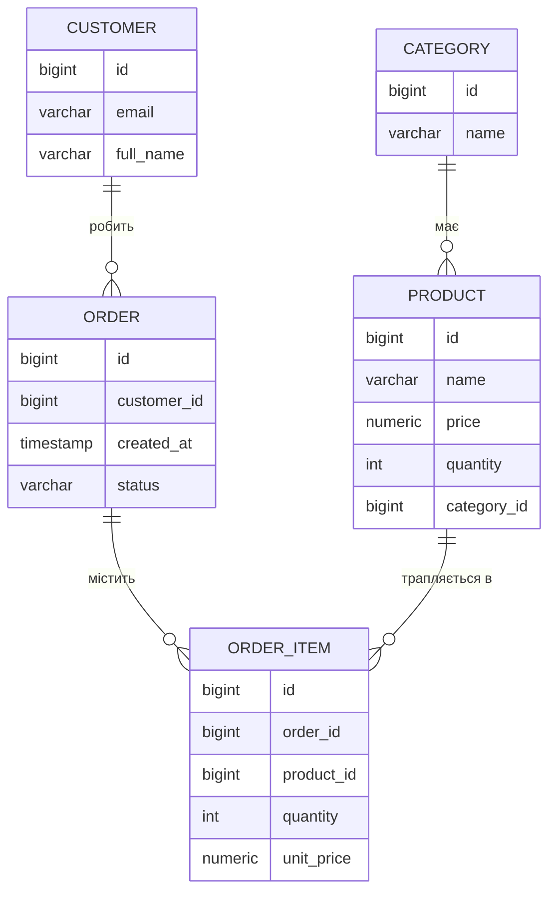
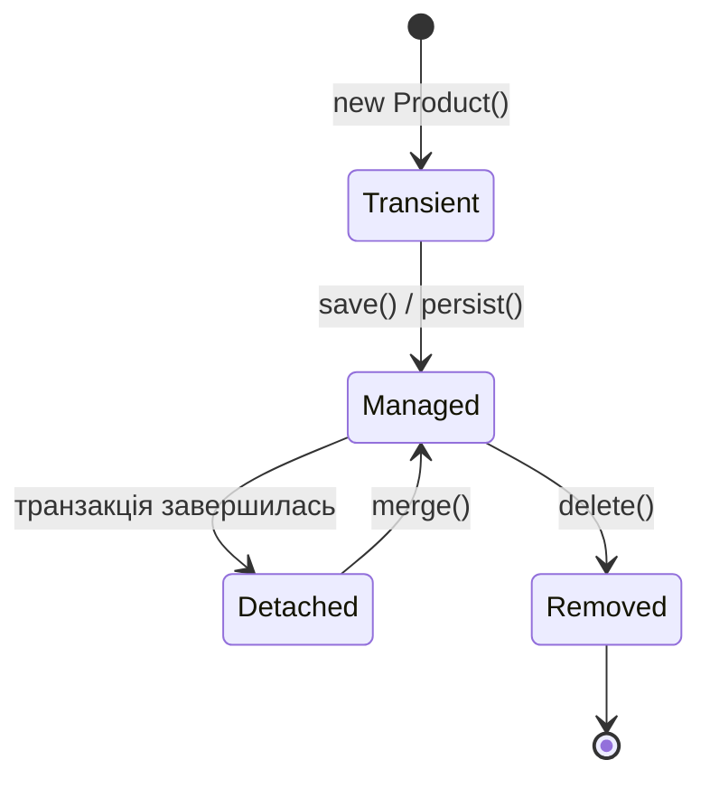

# Module 05 — Асоціації, сесія, життєвий цикл, транзакції

Досі в нас була одна сутність. Тепер проєкт обростає **звʼязками**: додаємо `Category`,
`Customer`, `Order`, `OrderItem` і повну схему магазину. Паралельно розберемо три поняття,
що визначають і коректність, і продуктивність роботи з БД: **сесія**, **життєвий цикл
сутності** та **транзакції**.

## Що навчимося
- Описувати звʼязки `@ManyToOne`, `@OneToMany`, а N:M — через асоціативну сутність.
- Розуміти, хто **власник звʼязку** і навіщо `mappedBy`.
- Розуміти **сесію** (Persistence Context) і **життєвий цикл** сутності.
- Бачити **dirty checking** (UPDATE без `save`) і причину **LazyInitializationException**.
- Проводити **межі транзакцій** через `@Transactional`.

## Передумови
- Пройдені [module-04](../module-04-crud-product/) (CRUD, шари, DTO) та
  [module-02](../module-02-jdbc-orm/) (зʼєднання, транзакція, ролі ORM).

---

## 1. Звʼязки між сутностями

У модулі 01 звʼязки виражалися зовнішніми ключами. Тепер — полями-обʼєктами.
Повна схема магазину:



### `@ManyToOne` + `@OneToMany` (звʼязок 1:N)

Приклад Category ↔ Product. **Власник звʼязку — той бік, де зовнішній ключ**, тобто `Product`:

```java
// Product.java — сторона "БАГАТО", ВЛАСНИК звʼязку (тут зовнішній ключ)
@ManyToOne(fetch = FetchType.LAZY)
@JoinColumn(name = "category_id")       // -> стовпець category_id у таблиці products
private Category category;
```

```java
// Category.java — сторона "ОДИН", ЗВОРОТНІЙ бік
@OneToMany(mappedBy = "category", cascade = CascadeType.ALL, orphanRemoval = true)
private List<Product> products = new ArrayList<>();
```

- `@JoinColumn(name = "category_id")` — створює **стовпець-зовнішній-ключ** у `products`.
- `mappedBy = "category"` — каже: «я не власник, власник — поле `category` в `Product`».
  Завдяки цьому на боці `Category` **ніякого стовпця не зʼявляється** — лише зручний доступ
  до списку товарів.

> **Типова помилка.** Якщо забути `mappedBy`, Hibernate вирішить, що це **два різні**
> звʼязки, і створить **зайву проміжну таблицю** `categories_products`. Правило: у
> двонапрямленому звʼязку сторона `@OneToMany` майже завжди має `mappedBy`.

### N:M через асоціативну сутність

Order і Product повʼязані «багато-до-багатьох». Але нам треба зберігати **кількість** і
**ціну на момент покупки** — тому замість «голого» `@ManyToMany` робимо окрему сутність
`OrderItem` із двома `@ManyToOne`:

```java
// OrderItem.java
@ManyToOne @JoinColumn(name = "order_id")   private Order order;      // -> order_id
@ManyToOne @JoinColumn(name = "product_id") private Product product;  // -> product_id
private Integer quantity;
private BigDecimal unitPrice;
```

---

## 2. SQL-місток: асоціації → схема

Запустіть застосунок — Hibernate згенерує DDL. Звʼязки перетворюються так:

| Анотація | Що зʼявляється в SQL |
|---|---|
| `@ManyToOne @JoinColumn(name="category_id")` в `Product` | стовпець `category_id bigint` + `foreign key (category_id) references categories` |
| `@OneToMany(mappedBy="category")` в `Category` | **нічого** — стовпця немає, лише навігація в коді |
| `@ManyToOne` в `OrderItem` × 2 | стовпці `order_id`, `product_id` + два зовнішні ключі |

Ключове спостереження: **`@OneToMany` з `mappedBy` НЕ створює стовпця**. Зовнішній ключ
завжди на боці `@ManyToOne` (сторона «багато»).

### Як звʼязки впливають на SELECT

- При `@ManyToOne(fetch = EAGER)` звернення до товару одразу дає `JOIN` із категорією.
- При `fetch = LAZY` (як у нас) — спершу `SELECT` товару, а категорія підвантажується
  **окремим** `SELECT` лише коли реально звернулись до `product.getCategory()`.

---

## 3. Сесія (Persistence Context)

**Сесія** (у JPA — *Persistence Context*, у Hibernate — `Session`) — це «робочий простір»
для сутностей у межах однієї транзакції. Поки сесія відкрита, вона:
- тримає завантажені сутності як **керовані** (managed);
- працює як **кеш першого рівня**: повторний `findById` того самого id у межах однієї
  транзакції НЕ піде в базу вдруге;
- **стежить за змінами** керованих сутностей (dirty checking, див. нижче).

Важливо: **межі сесії = межі транзакції**. Коли метод із `@Transactional` завершується,
транзакція комітиться, сесія закривається, і всі сутності стають **detached** (відʼєднані).

---

## 4. Життєвий цикл сутності



| Стан | Що це | Приклад |
|---|---|---|
| **transient** | новий обʼєкт, база про нього не знає | `new Product(...)` |
| **managed** | під наглядом сесії; зміни відстежуються | після `save()`, у межах транзакції |
| **detached** | був керованим, але сесія закрилась | повернули сутність із `@Transactional`-методу |
| **removed** | позначений на видалення | після `delete()` |

---

## 5. Dirty checking: UPDATE без `save`

Поки сутність **managed**, Hibernate сам помічає зміну її полів і генерує `UPDATE`
на завершенні транзакції. Дивіться `OrderDemoService.markOrderShipped`:

```java
@Transactional
public void markOrderShipped(Long orderId) {
    Order order = orderRepository.findById(orderId).orElseThrow();
    order.setStatus("SHIPPED");   // просто змінили поле
    // save() НЕ викликаємо — UPDATE піде автоматично на commit!
}
```

У логах ви побачите `select ...` (завантаження) і згодом `update orders set status=? ...` —
**без жодного явного `save`**. Це і є dirty checking.

---

## 6. LAZY, EAGER і LazyInitializationException

LAZY-звʼязок підвантажується лише при першому зверненні. Але звернутись можна **тільки поки
сесія відкрита**. Якщо спробувати після закриття транзакції — отримаємо
**`LazyInitializationException`**.

**Безпечно** (звернення в межах транзакції) — `OrderDemoService.countItemsSafely`:
```java
@Transactional(readOnly = true)
public int countItemsSafely(Long orderId) {
    Order order = orderRepository.findById(orderId).orElseThrow();
    return order.getItems().size();   // LAZY-підвантаження поки сесія жива — OK
}
```

**Небезпечно** (звернення після транзакції) — спроба зробити `order.getItems()` у контролері,
коли метод-сервіс уже повернув detached-сутність і сесія закрита, → виняток.

> **Як це оминають на практиці.** Саме тому в модулі 04 ми ввели **DTO**: з контролера
> повертаємо не сутність, а `...Response`, зібраний **усередині** транзакції. Тоді назовні
> йдуть «плоскі» дані, і LAZY-пасток немає. Ще варіанти — `JOIN FETCH` / `@EntityGraph`
> (їх детально застосуємо в [module-07](../module-07-liquibase-nplus1/) проти N+1).

---

## 7. Транзакції через `@Transactional`

У модулі 02 ми писали `BEGIN/COMMIT/ROLLBACK` руками. Тепер те саме робить анотація:

```java
@Transactional                 // BEGIN на вході, COMMIT на виході (або ROLLBACK при винятку)
public ... метод() { ... }
```

| Елемент | Значення |
|---|---|
| вхід у метод | відкривається транзакція і сесія |
| нормальне завершення | `COMMIT` + dirty checking згенерує потрібні `UPDATE` |
| виняток (`RuntimeException`) | `ROLLBACK` — зміни скасовуються |
| `readOnly = true` | підказка, що метод лише читає (оптимізація) |

Нагадування з модуля 04: `@Transactional` працює лише на **public**-методах і не спрацьовує
при виклику методу «самого себе» зсередини того ж класу (self-invocation).

---

## 8. Запуск

```bash
docker compose up -d
mvn spring-boot:run
```

При старті `DataSeeder` наповнить базу (категорії, товари, клієнт, замовлення з позиціями)
**каскадом** — достатньо зберегти кореневі обʼєкти, повʼязані збережуться автоматично.
У консолі побачите згенерований DDL (із зовнішніми ключами) та `insert`-и.

Перевірити схему зі звʼязками:
```bash
docker compose exec db psql -U shop -d shop -c "\d products"      # є стовпець category_id + FK
docker compose exec db psql -U shop -d shop -c "\d order_items"   # є order_id, product_id + FK
```

---

## Типові помилки

| Симптом | Причина | Як виправити |
|---|---|---|
| Створилась зайва таблиця `categories_products` | Забутий `mappedBy` на `@OneToMany` | Додати `mappedBy` на зворотному боці |
| `LazyInitializationException` | Доступ до LAZY-звʼязку поза транзакцією | Збирати DTO в межах транзакції / `JOIN FETCH` / `@EntityGraph` |
| Нескінченна JSON-рекурсія (Order→items→order→…) | Віддаєте двонапрямлені сутності назовні | Повертати DTO (не сутності) |
| `UPDATE` не відбувся | Зміна поля поза транзакцією (detached) | Міняти поле в межах `@Transactional` |
| `StackOverflowError` у `toString()` | Lombok `@ToString` по двонапрямленому звʼязку | Не генерувати toString по колекціях-звʼязках |

---

## Завдання для самостійного виконання

1. Запустіть застосунок і знайдіть у DDL **зовнішні ключі** для `products.category_id`,
   `orders.customer_id`, `order_items.order_id`, `order_items.product_id`.
2. Поясніть, чому `@OneToMany(mappedBy=...)` **не** додає стовпця в таблицю.
3. На основі `markOrderShipped` переконайтесь у логах, що `UPDATE` відбувається **без** `save`.
4. Поясніть своїми словами, за якої умови виникає `LazyInitializationException` і три способи
   його уникнути.

---

## Чеклист DoD

- [ ] У БД створено 5 таблиць із правильними зовнішніми ключами.
- [ ] `@OneToMany` з `mappedBy` не створює зайвих стовпців/таблиць.
- [ ] Можу пояснити, хто власник звʼязку і де живе зовнішній ключ.
- [ ] Розумію сесію (Persistence Context) та стани сутності.
- [ ] Можу пояснити dirty checking і причину `LazyInitializationException`.

---

## Що далі

У **[module-06-queries](../module-06-queries/)** навчимося писати запити засобами Spring Data:
derived-методи, JPQL, `@Query`, проєкції, пагінацію — і повернемось до **`GROUP BY`**,
цього разу через JPQL, звіривши згенерований SQL із тим, що писали руками в модулі 01.
